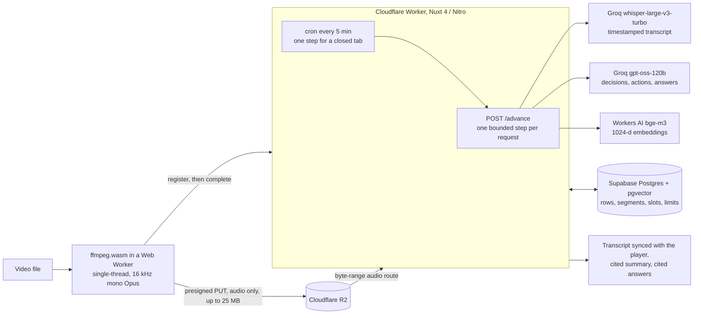

# MeetMind

**Meeting videos in. Searchable, timestamped knowledge out. No raw video ever leaves your browser.**

MeetMind turns a recorded meeting into a timestamped transcript, a summary of its decisions and
action items, and questions answered from what was said. Every summary item and every answer cites
the transcript line it comes from, and clicking the citation plays that moment. The video itself
stays on the user's machine. The browser extracts the audio with ffmpeg.wasm and compresses it to
16 kHz mono Opus, about 8.5 MB per meeting hour as measured, and only that audio is uploaded. Every
service it runs on is on its free plan.

**Live at <https://meetmind.elbaymalik.com>** since 2026-11-06, on a Cloudflare Worker with a public
demo meeting anyone can read and ask questions of. Uploading takes an invite code (below).

> Status: phases 0-9 and 13 of the [playbook](docs/PLAYBOOK.md) are built and deployed, and
> phase 10 in part (a rate rule at the edge and daily limits). A demo video is not recorded yet.
> What stays unproven is listed under [Limits](#limits).

This README is the design write-up. Each section gives the decision, the measurement behind it, and
the [ADR](#architecture-decision-records) that holds the full reasoning and the alternatives turned down.

## Architecture



- **The browser** does the heavy media work and drives the pipeline. While a meeting's page is open,
  it asks the server for one step at a time. One tab per browser drives, through `navigator.locks`,
  and the others only watch.
- **The Worker** holds every secret. Each request runs at most one provider call, which keeps it
  inside the free plan's limits on CPU and on requests to other services.
- **Postgres** keeps the meeting rows, the transcript segments, the embeddings, a ledger of provider
  slots that paces calls to Groq across every request, and the daily counts.
- **The cron** carries on with a meeting whose tab was closed, at one step every 5 minutes.

## Design decisions

### Audio is extracted in the browser ([ADR-0001](docs/adr/0001-client-side-audio-extraction.md), [ADR-0002](docs/adr/0002-ffmpeg-spike-results.md))

An hour of 720p video is about 1 GB. Uploading it would take the raw video off the user's machine,
and Groq takes at most 25 MB per transcription anyway. Whisper resamples everything to 16 kHz mono,
so MeetMind does that first, in the browser: `-ac 1 -ar 16000 -c:a libopus -b:a 16k`. The input is
mounted with WORKERFS, so the video is read in place and never copied into the 2 GB WebAssembly heap.

The spike measured this before anything else was built (2026-07-08, MacBook Air M5, headless Chrome,
production build):

| Input | Output | Time | Notes |
| --- | --- | --- | --- |
| 1045.8 MB, 1:00:00 of 720p | 8.11 MB of Opus | 16.0 / 16.5 / 16.0 s | about 225× real time, no out-of-memory in 3 of 3 runs |
| 30 s fixture | — | 140-145 ms | |

The JavaScript heap peaked at about 31 MB, and the realized bitrate of 18.9 kbps leaves room for
about 3 hours under the 25 MB cap. FLAC (about 55-75 MB an hour) and WAV (about 115 MB) would not
fit. The fixture was synthetic, and Safari and Firefox were not part of the spike.

**Single-thread, not multi-thread.** The multi-thread core is about twice as fast, but it needs
`SharedArrayBuffer`, which needs COOP/COEP headers on the whole site, which breaks embeds. Its own
project still calls it unstable. At 16 seconds for an hour, the faster core would save nothing worth
that price. The wasm file is 30.7 MiB, over the Workers asset limit of 25 MiB, so the Worker serves
it from the private bucket at the same path ([ADR-0018](docs/adr/0018-ffmpeg-wasm-from-private-r2.md)).

**One exception: the demo plays AAC.** WebKit lands seeks in Opus-in-Ogg about 4% early, and Safari
before 18.4 cannot play it at all. The public demo is the one meeting every visitor opens, so its
audio alone is AAC in M4A, put there by an operator ([ADR-0015](docs/adr/0015-invite-only-uploads.md)).
Uploads stay Ogg Opus.

### One transcription request per meeting ([ADR-0004](docs/adr/0004-transcription.md))

Groq's `whisper-large-v3-turbo` is free, fast, and returns segment timestamps. A 1-hour meeting is
one call of about 11 seconds and comes back as 828 segments. The audio is not chunked: Groq documents
no duration limit, the 25 MB cap is checked at registration, in the database and on completion, and
chunking would not lift the limit that binds, which is 7,200 seconds of audio an hour. Times are
stored as integer milliseconds from then on. The call is a plain `fetch`, with no SDK.

### Summaries cite the transcript, and the citations are checked ([ADR-0006](docs/adr/0006-structured-summaries.md))

Extraction uses `openai/gpt-oss-120b` on Groq, because only the gpt-oss models there support strict
structured outputs. The transcript is split on segment boundaries into chunks of about 2,500 tokens,
run one after another (about 9 chunks for an hour), and the results are reconciled into one summary.

- **Every item carries a quote, and the quote is checked.** The schema asks for the quote before the
  claim. Each quote is searched for in its own chunk of the transcript, and an item whose quote is not
  found is dropped. The timestamp comes from the line the quote was found in, not from the model. A
  quote may span up to 3 consecutive lines, which took the items kept on a test meeting from 16 of 73
  to 72 of 73. The check proves the words were said. It does not prove that they support the claim.
- **The chunk size was measured, not guessed.** A 5,000-token chunk came to about 9,800 tokens of
  request, and Groq answered 413. The default reply cap was eaten by 2,850-4,413 reasoning tokens.
  With reasoning set to low, a dense chunk's reply is about 1,780 tokens, 311 of them reasoning.
- **Neighbouring chunks are reconciled.** When two adjacent chunks report the same item from either
  side of their boundary, it is merged into one. That happens only if they cite lines at most 2 apart,
  share at least 2 content words, and those words are at least half of the shorter item's. A detail
  only one of them gives, such as a due date, is kept.

The prompt defines what counts as a decision and as an action item, and tells the model never to
report what was not decided. On the demo, regenerating the summary with these rules removed a
self-contradicting overview and a duplicated action, and found an action it had missed.

### Questions: dense retrieval over windows, answers held to the same check ([ADR-0007](docs/adr/0007-semantic-qa.md), [ADR-0014](docs/adr/0014-workers-ai-embeddings.md))

The transcript is embedded in windows of about 45 seconds (or 1,500 tokens), overlapping by one line
and never splitting one, with Cloudflare Workers AI's `@cf/baai/bge-m3` at 1024 dimensions. A
question retrieves the 4 nearest windows and is answered by the same gpt-oss model, which has to
quote the retrieved lines. Citations are checked against those lines only, and an answer with no
citation left is not shown.

- **Why bge-m3:** on a small test set it ranked the right passage first for 7 of 8 English and 8 of 8
  German questions. bge-base-en managed 1 of 8 in German, and it silently cuts input at 512 tokens.
- **Why dense only:** meetings are conversation, and people ask in other words than were spoken.
  Keyword search cannot match a reworded question. Hybrid search (tsvector with rank fusion) stays the
  next step if questions about names or figures start to miss.
- **Why no HNSW index:** a meeting has about 100 windows, so an exact scan is cheap. A filtered HNSW
  scan can also return fewer rows than asked for.

### A pipeline that fits the Workers free plan ([ADR-0012](docs/adr/0012-pipeline-orchestration.md))

The free plan gives a Worker 10 ms of CPU per request, 50 requests to other services, 100,000 requests
a day and 5 cron triggers. A meeting is therefore processed as many small steps instead of one job:

- `POST /advance` runs one bounded step (transcribe, one summary chunk, one batch of 16 embeddings,
  and so on) with at most one provider call. Measured, the costliest route makes 19
  requests to other services.
- A Postgres ledger of provider slots spaces the Groq chat calls one a minute across every request
  and every tab. A summary step does not wait for a slot. A question waits up to 20 seconds, then gets
  a 429 with `Retry-After`.
- Polling, not server-sent events. Queues, Durable Objects and Workflows were turned down: the page and
  a 5-minute cron are enough, and both are free.

Measured on the live site: a page costs about 96 ms of CPU cold and 13-19 ms warm, a cron tick 15-70
ms. These are above the nominal 10 ms, and still no CPU-limit error (1102) was seen. A 73-second recording with no tab open reached `ready` on the
cron alone, in 6 ticks.

### Privacy: the link is the key ([ADR-0013](docs/adr/0013-private-meeting-links.md), [ADR-0016](docs/adr/0016-real-services-or-nothing.md), [ADR-0017](docs/adr/0017-retention-purge.md))

There are no accounts. A meeting's link holds a random UUID, and no route lists meetings or searches
across them. "Your meetings" lives in the browser that uploaded them. A deployment runs on the real
services or answers 503: a stub or local store has to be turned on explicitly, and is refused on a
Worker. An optional purge deletes meetings past a retention period, and is off unless set.

## Performance and accessibility

Lighthouse 13.6.0 against the live site on 2026-11-08, one run per page, headless Chromium, default
mobile and desktop presets:

| Page | Preset | Performance | Accessibility | Best practices | LCP | CLS | TBT |
| --- | --- | --- | --- | --- | --- | --- | --- |
| Home | mobile | 100 | 100 | 100 | 1.0 s | 0 | 0 ms |
| Home | desktop | 100 | 100 | 100 | 0.3 s | 0 | 0 ms |
| Demo meeting | mobile | 98 | 100 | 100 | 1.1 s | 0 | 10 ms |
| Demo meeting | desktop | 100 | 100 | 100 | 0.3 s | 0.001 | 0 ms |

SEO scores 63 by design: every page sends `X-Robots-Tag: noindex, nofollow`, so no meeting page can
be indexed. The demo first scored 96 for accessibility: the timestamp on the playing line had a
contrast of 4.46:1, under the 4.5:1 required. It was fixed and the demo measured again the same day.

What is built for assistive technology, and checked by the headless browser drivers:

- The transcript is one tab stop with a roving focus. Arrow keys, Home and End move through the lines
  without scrolling the page, and the line being played carries `aria-current`.
- Progress, the countdown before a retry, and answers are announced through polite live regions, and
  errors through alerts. The countdown is kept out of the live region so it is not read every second.
- Focus moves to the answer once it arrives, and to the progress heading when the button just pressed
  disappears.
- The player is the browser's native `<audio controls>`, because the waveform library considered has
  no accessibility support. The spinner stops under `prefers-reduced-motion`.

## Cost and capacity

Every service is on its free plan, and R2 has no spending cap, so the application enforces its own.
The capacity figures below are arithmetic from the measurements above, not measured on the live site.

| Service | Free plan | One meeting hour uses | What bounds it in MeetMind |
| --- | --- | --- | --- |
| Cloudflare R2 | 10 GB-month, 1M class A / 10M class B ops a month | about 8.5 MB | a storage budget (default 8 GiB) refuses new uploads with 507, and a lifecycle rule deletes audio after 30 days ([ADR-0010](docs/adr/0010-r2-cost-controls.md)) |
| Groq Whisper | 7,200 audio seconds an hour | 3,600 seconds, one request | the 25 MB cap |
| Groq gpt-oss-120b | 8K tokens a minute, 200K a day | about 9 requests, an estimated 50K tokens | one chat call a minute app-wide, and daily question counts |
| Workers AI | 10,000 neurons a day | an estimated 20 neurons | — |
| Cloudflare Workers | 100,000 requests a day, 10 ms CPU each | an estimated 40-60 requests | a rate rule at the edge |
| Supabase | 500 MB database | segments and about 100 embeddings | — |

Product limits, all in UTC days: the public demo answers 25 questions a day
([ADR-0019](docs/adr/0019-demo-question-cap.md)), every other meeting 100, and at most 30 new
meetings are registered across the app ([ADR-0020](docs/adr/0020-daily-limits.md)). The demo's reads
are cached at the edge for an hour.

## Testing

About 4,200 tests: 3,323 unit and Nuxt-runtime tests, 703 against the built server routes, 137 that run
the real Supabase drivers against a throwaway Postgres behind PostgREST, and 31 against the real R2,
Supabase, Groq and Workers AI. `pnpm ci:local` runs the 8 CI jobs on this machine (lint, typecheck,
unit tests, dependency audit, server routes, migrations, PostgREST, and the headless browser drivers),
and it is the gate for every merge. Separate scripts run the built Worker under local workerd for
its service gate, its cron and its streaming.

## Limits

- The extraction spike used a synthetic recording, in Chrome only. Safari and Firefox upload paths
  are not measured.
- There are no speaker labels, so an action someone takes on with "I'll do it" has no owner.
- A due date is kept as said ("by next Friday"), not resolved to a date.
- The citation check proves a quote exists, not that it supports the claim made from it.
- The byte cap admits about 2.9 hours of audio, while Groq's hourly audio budget is 2 hours.
- Whether the cron's database write counts as activity for Supabase's 7-day pause is unproven.
- The capacity figures in the table above are estimates.

## Who can see a meeting

MeetMind is a portfolio demo with no accounts, so **a meeting's link is the only key to
it**. The link holds a random UUID, and nothing on the server lists meetings or searches
across them. "Your meetings" is a list kept only in the browser that uploaded them, so
losing the link loses access, and anyone given the link can read the meeting. A leaked
link can only be revoked by an operator deleting the meeting. Nothing deletes a meeting by
itself, unless someone turns on the optional purge in
[ADR-0017](docs/adr/0017-retention-purge.md), and then the upload page says so. Do not upload anything
sensitive: audio goes to Groq and is stored at Cloudflare, transcripts and questions go to
Groq and Cloudflare. See [ADR-0013](docs/adr/0013-private-meeting-links.md), including its
limits.

## Who can upload

Public visitors get the demo meeting, and **uploading takes an invite code**. Set
`NUXT_INVITE_CODE` to at least 32 characters (`openssl rand -hex 24`) and give it to whoever
may upload; it is sent in a request header and kept only in the page's memory. Leaving it out
never selects a stub, even under `pnpm dev`: **unset or too short, uploads are closed
for everyone**. It is one shared code, so rotating it locks everyone out of uploading, and
existing links keep working. At most 30 new meetings are registered across the whole app in a
UTC day, counted only once the code has passed ([ADR-0020](docs/adr/0020-daily-limits.md)).

Set `NUXT_PUBLIC_DEMO_MEETING_ID` to link one finished meeting from the home page. Anyone can
read that meeting and ask it questions, which spends the shared quotas, and nobody can change
it through its link. Its questions are capped by `NUXT_DEMO_QUESTIONS_PER_DAY` (default 25, by UTC
day) and refused while another meeting is summarizing or indexing, or for an hour after one failed
at extraction ([ADR-0019](docs/adr/0019-demo-question-cap.md)). No tick retries a failed one and
nothing logs the pause, but a retry starts it again. Every other meeting answers at most 100
questions a UTC day ([ADR-0020](docs/adr/0020-daily-limits.md)). Its audio expires with the bucket's lifecycle rule (below) like any other,
so it has to be put back every 30 days or the player stops working. To create it, see "Creating
the demo meeting" in [ADR-0015](docs/adr/0015-invite-only-uploads.md), which also records what guards every route
that can write, and what this does not do.

## Architecture Decision Records

| ADR | Decision |
| --- | --- |
| [0001](docs/adr/0001-client-side-audio-extraction.md) | Client-side audio extraction: single-thread ffmpeg.wasm, Opus 16 kHz mono |
| [0002](docs/adr/0002-ffmpeg-spike-results.md) | FFmpeg WASM spike results (measured numbers) |
| [0003](docs/adr/0003-upload-and-storage.md) | Upload & storage: direct-to-R2 presigned PUT, Supabase Postgres metadata, local drivers for dev/CI |
| [0004](docs/adr/0004-transcription.md) | Transcription: one request per meeting, no chunking, stub provider for credential-free dev |
| [0005](docs/adr/0005-audio-playback-and-transcript-sync.md) | Playback: same-origin byte-range route, native player before a waveform |
| [0006](docs/adr/0006-structured-summaries.md) | Summaries: chunked extraction, citations checked against the transcript |
| [0007](docs/adr/0007-semantic-qa.md) | Semantic Q&A: windowed embeddings, answers held to the same citation check. Its choice of provider is superseded by ADR-0014 |
| [0008](docs/adr/0008-cross-meeting-search.md) | Cross-meeting search: passages across meetings, not a synthesized answer; still no HNSW. Superseded by ADR-0013 |
| [0009](docs/adr/0009-workers-measurement-spike.md) | Workers measurement spike before Phase 9: what the runtime actually does, measured rather than inferred |
| [0010](docs/adr/0010-r2-cost-controls.md) | R2 cost controls: a lifecycle rule bounds growth, an application storage budget is the hard stop, per-request op metering rejected |
| [0011](docs/adr/0011-admin-meeting-delete.md) | Deleting a meeting is admin-only, behind `NUXT_ADMIN_TOKEN`; refused while anything could still write its data. Its addendum adds the admin route that makes a finished meeting's summary again, the demo's included |
| [0012](docs/adr/0012-pipeline-orchestration.md) | Pipeline orchestration on the Workers free plan: one bounded step per request, driven by the open page with no click and one driving tab per browser, Postgres rate-limit slots, polling not SSE, and a cron that moves a closed tab's meeting very slowly |
| [0013](docs/adr/0013-private-meeting-links.md) | A meeting is reached only through its unguessable link: no global list or cross-meeting search, \"Your meetings\" lives in this browser |
| [0014](docs/adr/0014-workers-ai-embeddings.md) | Embeddings from Cloudflare Workers AI's bge-m3 at 1024 dimensions, replacing a provider whose terms require a paid plan in the EEA: measured batch limits, and a plain message at the daily limit |
| [0015](docs/adr/0015-invite-only-uploads.md) | Visitors get the demo meeting, which can only be read and asked; uploading takes an invite code, and a missing code closes it. A guard for every route that can write |
| [0016](docs/adr/0016-real-services-or-nothing.md) | A deployment runs on the real services or answers 503: stubs and local stores need an explicit opt-in, and are refused beside real stored data and on a Worker |
| [0017](docs/adr/0017-retention-purge.md) | An optional purge deletes a meeting past its retention days, one per cron tick, never the demo or anything a step is live on. Off until someone turns it on |
| [0018](docs/adr/0018-ffmpeg-wasm-from-private-r2.md) | A Worker serves ffmpeg's wasm from the private bucket at the same path, one hardcoded key by version, since it is over the asset limit. Live since 2026-11-06 |
| [0019](docs/adr/0019-demo-question-cap.md) | Questions on the public demo have a daily count and stop while an extraction is pending: a read before the provider slot, the count taken after it. Deployed 2026-11-06, in force since 2026-11-07 when the demo's id was set |
| [0020](docs/adr/0020-daily-limits.md) | Every other meeting has a daily count of questions of its own, in the demo's design, and new meetings have a daily ceiling across the app, counted after the invite code. Deployed 2026-11-07 |

New decisions follow the [ADR template](docs/adr/0000-template.md).

## Project structure

```
app/            Nuxt 4 app: pages (home, your meetings, a meeting, its progress), layouts, components, composables
app/workers/    Web Worker sources (ffmpeg orchestration) — not auto-imported
server/api/     Nitro routes — the only place secrets are read
server/routes/  The one route outside /api: ffmpeg's wasm on a Worker
server/utils/   Storage drivers (R2 | local fs) and meeting repositories (Supabase | local JSON)
shared/         Isomorphic code: `utils/` + `types/` (auto-imported), `schemas/` (zod, explicit import)
supabase/       SQL migrations for the Postgres schema
public/ffmpeg/  Self-hosted ffmpeg.wasm core assets (copied on postinstall, gitignored). A Worker build leaves the wasm out
scripts/        Fixtures, headless-browser drivers, local workerd checks, migrations and deploy
docs/           Playbook + ADRs
tests/          Vitest: `unit/`, Nuxt-runtime `nuxt/`, and server-route `e2e/` (built app),
                `postgrest/` (throwaway Postgres) and `services/` (the real services)
.data/          Local drivers' audio + meeting rows (gitignored; only without R2/Supabase)
```

## Setup

Requires Node 24 (pinned in `.node-version`; [fnm](https://github.com/Schniz/fnm) picks it
up automatically) and pnpm via corepack:

```bash
corepack enable
pnpm install        # also copies ffmpeg core assets into public/ffmpeg/
cp .env.example .env  # then set NUXT_INVITE_CODE, and any cloud credentials (see below)
pnpm dev            # http://localhost:3000
```

Under `pnpm dev`, without any credentials, the app is fully usable: uploaded audio and
meeting rows are kept under `.data/` by the local drivers, and stubs stand in for Groq and
Workers AI. The one setting you need even so is `NUXT_INVITE_CODE`, since without it uploading
is closed (see [Who can upload](#who-can-upload)). Set the variables below to switch to the
production services. Groq and Workers AI can each be switched alone, while the stores are
local. Supabase and R2 go together, and with either of them everything has to be real (see
[What a deployment needs](#what-a-deployment-needs)).

Once real keys are in place, `pnpm test:services` checks each one against the driver
that uses it — presigned uploads and CORS on R2, the schema and triggers on Supabase,
whether Groq's response really has the shape the parser assumes, and that Workers AI
returns 1024-dimension vectors, refuses an input over its limit rather than cutting it,
and ranks the right passage first for a reworded question in English and in German.
Those contracts are the one thing the offline tests cannot prove.

### What a deployment needs

A built server has no stand-ins. It needs `NUXT_GROQ_API_KEY`, `NUXT_WORKERS_AI_ACCOUNT_ID`,
`NUXT_WORKERS_AI_API_TOKEN`, `NUXT_SUPABASE_URL`, `NUXT_SUPABASE_SERVICE_KEY`,
`NUXT_R2_ACCOUNT_ID`, `NUXT_R2_ACCESS_KEY_ID`, `NUXT_R2_SECRET_ACCESS_KEY` and `NUXT_R2_BUCKET`.
With any of them missing, every route that needs a provider or store answers 503 with one message
that names nothing, before anything is claimed, called or written, and the server log names
what is missing, never a value. The home page and `/api/health` still answer, and a meeting's page
shows a plain failure. [ADR-0016](docs/adr/0016-real-services-or-nothing.md) has the reasons.
`pnpm secrets:worker` sends these from `.env`, with `NUXT_INVITE_CODE`, `NUXT_R2_RETENTION_DAYS` and
`NUXT_ADMIN_TOKEN`, and nothing else: see "Deploying the Worker" below.

| Running | Every setting present | Some missing, stores local | A real database or bucket, something else missing | Half of a group |
| --- | --- | --- | --- | --- |
| A Cloudflare Worker | Real services | **503** | **503** | **503** |
| A built server | Real services | **503** | **503** | **503** |
| A built server with `NUXT_ALLOW_LOCAL_DRIVERS=true` | Real services | Stand-ins for what is missing | **503** | **503** |
| `pnpm dev` | Real services | Stand-ins for what is missing | **503** | **503** |

`NUXT_ALLOW_LOCAL_DRIVERS=true` is for the e2e and browser jobs, which run a production build
on local drivers. A deployment does not set it: a Worker ignores it outright, and so does
any server beside a real database. It does not belong in `wrangler.jsonc`, or in a real `.env`.
`node .output/server/index.mjs` reads no dotenv file, so without the opt-in it refuses unless the
environment holds all nine settings. `pnpm preview` is different, because `nuxt preview` loads `.env`
into the server it starts: with a full `.env` it runs on the real services, as `pnpm dev` does, so an
upload through it writes real data and spends quota. An opt-in in that `.env` opens it too.

### Storage setup (Cloudflare R2)

1. Create an R2 bucket.
2. Add a CORS policy to the bucket, so the browser may PUT to presigned URLs.
   Without it uploads fail **only in a real browser** — never in the tests.

   ```bash
   npx wrangler r2 bucket cors set <bucket> --file infra/r2-cors.json
   ```

   `infra/r2-cors.json` has the deployed origin and localhost, and setting it replaces the whole
   policy, so keep both. Note the
   dashboard (bucket → Settings → CORS Policy) takes a *different*, S3-style
   shape for the same policy — `[{"AllowedOrigins": [...], "AllowedMethods":
   [...]}]` — and wrangler rejects it. Each tool is right for itself; the
   committed file is the wrangler one.

3. Bound the cost. R2 has **no spending cap** — overage is billed, and the only
   usage notification needs a Professional plan — so the limits have to be built:

   ```bash
   # Expire audio so storage cannot grow without bound. Scoped to the app's keys.
   npx wrangler r2 bucket lifecycle add <bucket> expire-meeting-audio-30d meetings/ --expire-days 30
   ```

   Do **not** add a bucket lock: it blocks the rule above and makes the bucket
   impossible to empty. Note a lifecycle rule bounds slow growth only — it does
   nothing against a burst.

   The hard stop is server-side: `POST /api/meetings` answers **507** once the
   stored bytes plus the incoming upload would cross `NUXT_R2_MAX_STORED_BYTES`
   (default 8 GiB). Set `NUXT_R2_RETENTION_DAYS` to the **same number of days as
   the lifecycle rule** — it is how the byte estimate knows which uploads
   Cloudflare has already deleted, and nothing in the app can verify the two
   agree. See [ADR-0010](docs/adr/0010-r2-cost-controls.md).

   Space is reclaimed by deleting meetings, which is an operator task. Set
   `NUXT_ADMIN_TOKEN` (at least 32 characters, e.g. `openssl rand -base64 32`),
   then:

   ```bash
   curl -X DELETE -H "Authorization: Bearer $NUXT_ADMIN_TOKEN" \
     https://<host>/api/meetings/<id>
   ```

   That removes the audio, transcript, summary and search index, and the bytes
   stop counting against the ceiling at once. Without the token the route
   answers 404. It answers 409 for 20 minutes after a meeting is registered (the
   5-minute upload link plus 15 minutes' grace), and
   while transcription or summarisation is running. See
   [ADR-0011](docs/adr/0011-admin-meeting-delete.md). No API lists meetings, so the
   id comes from the meeting's link or from the Supabase table.

4. Set `NUXT_R2_ACCOUNT_ID`, `NUXT_R2_ACCESS_KEY_ID`, `NUXT_R2_SECRET_ACCESS_KEY`,
   `NUXT_R2_BUCKET`. Scope the token to the one bucket with **Object Read & Write**
   — only the Object scopes can be bucket-scoped, and an Admin token could create
   or delete buckets if it leaked.

### Transcription setup (Groq)

Set `NUXT_GROQ_API_KEY` to transcribe with Whisper Large v3 Turbo. Without it `pnpm dev`
uses a deterministic stub transcriber, so the whole pipeline still runs.

Note the free tier allows 7,200 audio-seconds per rolling hour, about two hours of
audio. A recording longer than that uploads successfully and then hits the provider's
quota; the UI reports it as such.

### Embeddings setup (Cloudflare Workers AI)

Set `NUXT_WORKERS_AI_ACCOUNT_ID` and `NUXT_WORKERS_AI_API_TOKEN` (both, or neither) to
index meetings with `@cf/baai/bge-m3`. The token should be scoped to Workers AI alone.
Without them `pnpm dev` embeds with a deterministic stub, so indexing and questions still
run.

The Workers Free plan allows 10,000 neurons a day, resetting at 00:00 UTC, and has no
overage to bill. At about 1,075 neurons per million tokens that is roughly 9 million tokens.
Past it, indexing and questions are refused until the reset with a message saying so, and
indexing resumes from where it stopped. See
[ADR-0014](docs/adr/0014-workers-ai-embeddings.md).

### Database setup (Supabase)

1. Create a Supabase project, put its **Session pooler** connection string in
   `SUPABASE_DB_URL` (dashboard -> Connect; the port must be 5432, and the
   `[YOUR-PASSWORD]` placeholder has to be replaced by hand), then run
   `pnpm db:migrate`. It applies `supabase/migrations/*.sql` in timestamp order
   -- which matters, since later migrations backfill and replace what earlier
   ones create -- and records each one so a re-run is a no-op.
2. Set `NUXT_SUPABASE_URL` and `NUXT_SUPABASE_SERVICE_KEY` (the **service-role** key —
   it stays on the server; the table has RLS enabled with no policies).

### Deploying the Worker (Phase 13)

The Worker has served <https://meetmind.elbaymalik.com> since 2026-11-06, on the Workers free plan and
on that custom domain only: `workers.dev` and preview URLs are off. These are the steps it was deployed
by, in order, kept for deploying it again from nothing, and what steps 7 to 10 measured on 2026-11-06
and 07 is noted under each. Every step past the first changes something real.

Wrangler reads `CLOUDFLARE_API_TOKEN` from `.env` when run here. A token cannot read its own rights,
so check in the dashboard that it can edit Workers scripts, routes and custom domains on the zone, and write R2 objects.

**Never run `wrangler dev` at the repo root on a Worker build.** Only the wasm used to stop it, and
that is gone from the build. It reads the real `.env`, so it writes to the real database and
spends real quota. `scripts/verify-worker-*.mjs` run it from a temporary copy, with fakes.

1. **Check the code.** `pnpm ci:local`, then under a Worker build the three scripts, and `pnpm build` afterwards:

   ```bash
   NITRO_PRESET=cloudflare_module pnpm build
   node scripts/verify-worker-gate.mjs
   node scripts/verify-worker-sweep.mjs
   node scripts/verify-worker-streams.mjs
   pnpm build
   ```

2. **Apply the migrations.** `scripts/verify-migrations.sh`, then `pnpm db:migrate`. Without
   `20261103180000_sweeper.sql` every tick fails, and without `20261104120000_demo_question_cap.sql`
   every question on the demo is refused, and nothing else is.
3. **Put the wasm in the private bucket.** `pnpm upload:ffmpeg-wasm`. It is over the asset limit, so
   a route serves it from there ([ADR-0018](docs/adr/0018-ffmpeg-wasm-from-private-r2.md)). The bucket stays private.
4. **Set the bucket's CORS**, or uploads fail in a real browser only, and so does creating the demo:

   ```bash
   npx wrangler r2 bucket cors set meet-mind --file infra/r2-cors.json
   ```

   This replaces the whole policy, which is why the file keeps localhost.
   `VERIFY_ORIGIN=https://meetmind.elbaymalik.com pnpm test:services` checks the preflight.
   Do it before step 6: once the Worker is live it must not run (see below).
5. **Send the secrets.** Put a new `NUXT_ADMIN_TOKEN` in `.env` (`openssl rand -base64 32`), so someone
   holds it. Then `pnpm secrets:worker`, which sends these twelve and nothing else, refuses if one is
   missing, and prints names only: `NUXT_GROQ_API_KEY`, `NUXT_WORKERS_AI_ACCOUNT_ID`,
   `NUXT_WORKERS_AI_API_TOKEN`, `NUXT_SUPABASE_URL`, `NUXT_SUPABASE_SERVICE_KEY`, `NUXT_R2_ACCOUNT_ID`,
   `NUXT_R2_ACCESS_KEY_ID`, `NUXT_R2_SECRET_ACCESS_KEY`, `NUXT_R2_BUCKET`, `NUXT_INVITE_CODE`,
   `NUXT_R2_RETENTION_DAYS`, `NUXT_ADMIN_TOKEN`. With no Worker yet, this creates a placeholder, and
   the deploy keeps its secrets. **Never `wrangler secret bulk .env`:** it uploads every key in the file,
   the wrangler token and the database URL included. `NUXT_PUBLIC_DEMO_MEETING_ID` stays unset until step 10.
6. **Deploy.** `pnpm deploy:worker`. It builds for Workers, refuses a build that is not one or that still
   has the wasm, runs `wrangler deploy`, and then runs `pnpm build`, so the Node build is back even on
   failure or a Ctrl-C. A second Ctrl-C during that last build stops it, and then it says to run
   `pnpm build` by hand. A Ctrl-C during `wrangler deploy` may leave it live or not, and
   `pnpm exec wrangler deployments list` says which. That makes the site live and registers the cron in `wrangler.jsonc`: one tick every 5
   minutes, of the 5 crons the free plan allows. It can take up to 15 minutes to reach Cloudflare's
   network, and a new Worker up to 30 to show in Past Cron Events. The database is empty at first, so
   a tick spends nothing.
7. **Add the rate rule, straight after.** The free plan's 100,000 requests a day are per account, shared
   by every Worker on it, so one address is held to a steady rate at the edge. In the dashboard:
   `elbaymalik.com`, Security, WAF, Rate limiting rules. The one rule the free plan allows: 10 requests
   in 10 seconds, counted per IP and data centre (characteristics `ip.src` and `cf.colo.id`), block for
   10 seconds, on any path not starting with `/_nuxt/`, so a page's static assets do not count towards it.
   The live expression is:

   ```text
   (http.host eq "meetmind.elbaymalik.com" and not (starts_with(raw.http.request.uri.path, "/_nuxt/") and starts_with(http.request.uri.path, "/_nuxt/")))
   ```

   A path is left out only if it starts with `/_nuxt/` both as sent (`raw.http.request.uri.path`) and
   after Cloudflare normalises it (`http.request.uri.path`), so every request that runs the Worker is
   counted. That leaves out a path with no asset too, which would run the Worker uncounted, so
   `run_worker_first` in `wrangler.jsonc` keeps everything under `/_nuxt/` away from the Worker, found or
   not. A blocked request never reaches the Worker. Measured on the live site: `/`, `/%5Fnuxt/x` and a
   path with dot segments answered 429 after 10 requests, and `/_nuxt/` paths of real assets were never
   blocked. If real audio seeks trip it, raising the count loosens that hold. It stops one address and not
   many, and a stranger's questions are capped separately
   ([ADR-0019](docs/adr/0019-demo-question-cap.md)).
8. **Look at it before telling anyone.** These are the checks, with what they found on the live site:
   - Load `/` from cold and read its CPU in the Worker's logs, and any 1102. It was about 96 ms cold and
     13 to 19 ms warm, a cron tick 15 to 70 ms, and no 1102 was seen.
   - `curl -sS -o /dev/null -D - https://meetmind.elbaymalik.com/ffmpeg/ffmpeg-core.wasm` says 200 and
     `application/wasm`. Not with `curl -I`, as the route answers only a GET.
   - Read one invocation's log for the invite header (step 9 says what it showed).
   - `/__scheduled` and `/cdn-cgi/local/scheduled` run no tick. Both answer 404 on the live site.
   - `workers.dev` does not answer.
   - `/_nuxt/no-such-file` answers 404 with no invocation in `wrangler tail`: a missing asset does not
     run the Worker.
   - `/%5Fnuxt/no-such-file`, and a path with a dot segment such as `/_nuxt/../api/health`, are counted
     by the rule: each answers 429 after 10 requests in 10 seconds. Under `wrangler dev`, which
     normalises nothing, the first does run the Worker, which is why step 7's expression reads both
     fields.
9. **Run the acceptance.** Upload a short real meeting, close the tab, and watch it reach `ready`. A
   line in `wrangler tail` says a step ran, and a tick with nothing to do logs nothing.
   Delete it afterwards with the admin token. Read Whisper's CPU while you are there. On the live site a
   73-second recording reached `ready` in about 30 minutes from the 5-minute cron alone, in 6 ticks with
   no errors. The invite code never appeared in the tail's output, and the admin delete answered 204
   and removed the object from R2.
10. **Create the demo.** See "Creating the demo meeting" in
    [ADR-0015](docs/adr/0015-invite-only-uploads.md). Only once it is finished,
    `wrangler secret put NUXT_PUBLIC_DEMO_MEETING_ID`. Then check it in a private window, including
    the page's CPU, and audio seeks in Safari: select a line far into the recording and compare the words
    you hear with the highlighted line, because `currentTime` says the right number even when the audio is
    early. Click from the home page to the demo, to Pipeline and back, within ten seconds: the rate rule
    may block that, and the page should recover by itself within about 11 seconds. A full page load during
    the block shows Cloudflare's own page, with none of the app on it, until it is reloaded: a custom block
    response needs the Pro plan. Paste the home
    page's link into [LinkedIn's Post Inspector](https://www.linkedin.com/post-inspector/) and check the preview.
    The live demo is a 23-minute engineering incident review (23:09 of audio, 314 transcript lines),
    read from a written script in four voices by the Kokoro-82M text-to-speech model (Apache 2.0) and
    uploaded through the app itself. Only its audio was then swapped for AAC in M4A, by ADR-0015's
    recipe. Its finished transcript and summary come from the Worker's edge cache, for an hour in each
    data centre, and the responses say which with `x-demo-cache: hit` or `miss` (ADR-0015's decision 5).

**`pnpm test:services`, and a local server on `.env`, must not run during acceptance.** There is no
staging. Both share the one real database with the live cron, so a tick can pick up the rows they
insert, and spend real quota on them. **Past Cron Events is the proof that the cron fires, and
`last_tick_at` is not**, because `test:services` moves it too, with nothing deployed.

**To roll back,** name the version: `pnpm exec wrangler versions list`, then
`pnpm exec wrangler rollback <version-id>`. Leave any older wasm in the bucket, as that version asks
for its own.

**Once step 10 is done, roll back only to a version created after it.** The live Worker has the demo's
id set, so this holds now. Secrets belong to a version, and
`wrangler secret put` makes one, so a plain `wrangler rollback` straight after step 10 goes back to a
version with no `NUXT_PUBLIC_DEMO_MEETING_ID`. There the demo has no question count, no pause for
extraction and no read-only guard, and its id is already known. Wrangler's prompt names that secret as
changed and does not say any of this, so if it lists the name, answer no.
`pnpm exec wrangler versions secret list` should still name it afterwards. Putting the secret back
afterwards is no repair, as wrangler refuses `wrangler secret put` while the latest version is not the
deployed one. If no version after step 10 has the code you want, check out the last good commit and run
`pnpm deploy:worker` rather than rolling back. A deploy should keep the secrets.

**To make a finished meeting's summary again,** the demo's included and with
`NUXT_PUBLIC_DEMO_MEETING_ID` left set, send the admin token:

```bash
curl -X POST -H "Authorization: Bearer $NUXT_ADMIN_TOKEN" https://<host>/api/meetings/<id>/resummarize
```

It answers 202 once the meeting is back in extraction with a new plan, and the cron finishes it, one
chunk a tick. Its transcript, index and audio are not touched, and the old summary stays stored until
the new one replaces it, though the meeting page shows no summary until then, and the demo's questions
pause meanwhile. It answers 409 for a meeting that is not `ready` (or failed at extraction) with a
complete index, and 404 with no token configured. The cron takes the demo's steps only once
`20261108120000_sweep_demo_extraction.sql` is applied. See [ADR-0011](docs/adr/0011-admin-meeting-delete.md)'s
resummarize addendum.

**To stop the ticks,** set `"crons": []` in `wrangler.jsonc` and run `pnpm exec wrangler triggers deploy`,
which changes the triggers and uploads no code, or remove the trigger in the dashboard. Do not use
`pnpm deploy:worker` for this after a rollback: it builds and deploys the checkout, which puts the code
just rolled back from live again, with only the cron gone. Undo the edit before the next deploy, or that
deploy leaves the ticks off.

All of that comes from wrangler's code and Cloudflare's docs, and has not been run here. Wrangler marks
`triggers deploy` as experimental.

**The retention purge is off, and nothing here turns it on.** Set `NUXT_RETENTION_PURGE_DAYS` with
`wrangler secret put` to have a tick with nothing else to do delete one meeting past that many days:
its row, transcript, summary, index and audio, for good, at most 288 a day. It needs
`20261103190000_retention_purge.sql` applied, and `NUXT_PUBLIC_DEMO_MEETING_ID` naming a real
meeting, or it deletes nothing. A demo id naming no meeting says so once per isolate, and a
migration not applied says only `sweep failed: Error`, on each tick with nothing else to do. The
upload page says how many days from the setting, a well-formed id and being a Worker, with no
read of the database, so it goes on promising deletion in both of those cases: check both when
turning this on. Run the query in [ADR-0017](docs/adr/0017-retention-purge.md) first, to see what
the first days would delete.

The sweeper is also what keeps a free Supabase project from pausing: every tick writes one row,
including one with nothing to do. Whether Supabase counts that as activity is not known yet, so
watch the project's first idle week. See [ADR-0012](docs/adr/0012-pipeline-orchestration.md)'s step 11
addendum for what a tick retries, which is no failed stage, and what stays unproven.

## Scripts

| Script | Purpose |
| --- | --- |
| `pnpm dev` / `pnpm build` / `pnpm preview` | Develop, build, preview |
| `pnpm lint` / `pnpm lint:fix` | ESLint (flat config, stylistic rules) |
| `pnpm typecheck` | `nuxt typecheck` (vue-tsc, strict) |
| `pnpm test` / `pnpm test:watch` | Vitest unit + Nuxt-runtime tests |
| `pnpm test:e2e` | Builds the app, then tests the Nitro routes against the local drivers |
| `pnpm test:services` | Exercises the real R2, Supabase, Groq and Workers AI services; each group is skipped unless its keys are set, and the banner names which ones skipped |
| `NUXT_INVITE_CODE=<code> node scripts/drive-upload.mjs <url> [fixture] [dataDir]` | Headless Chromium: wrong code, right code, drop → extract → upload → progress page, inspects storage, then checks the page reaches `ready` with no click, a second tab that only watches and takes over, leaving and coming back, and the read-only demo, all by the requests each tab was seen to send. Takes the code the server was started with, and a server on local drivers, so started with `NUXT_ALLOW_LOCAL_DRIVERS=true` if built |
| `node scripts/drive-player.mjs <url> <meetingId>` | Headless Chromium: click-to-seek, active-line highlight, transcript keyboard navigation |
| `NITRO_PRESET=cloudflare_module pnpm build && node scripts/verify-worker-gate.mjs` | Runs the Worker build under local workerd with fake services, and checks what it refuses and what it selects ([ADR-0016](docs/adr/0016-real-services-or-nothing.md)). Run `pnpm build` afterwards, since the other jobs need the Node build |
| `pnpm test:postgrest` | The real Supabase drivers against a throwaway Postgres behind PostgREST (Docker). No credentials, and no real project. A job in `pnpm ci:local` |
| `NITRO_PRESET=cloudflare_module pnpm build && node scripts/verify-worker-sweep.mjs` | Not in `pnpm ci:local`, as it needs its own build: run it by hand before merging a change to the sweeper or the purge. Runs the Worker build under local workerd and asks it for cron ticks, against real SQL on a throwaway Postgres and fake providers: a meeting with no tab open reaches `ready`, a tick with nothing to do still writes to Postgres, and what it refuses and leaves alone. Then `pnpm build` to put the Node build back |
| `NITRO_PRESET=cloudflare_module pnpm build && node scripts/verify-worker-streams.mjs` | Not in `pnpm ci:local`, as it needs its own build. Serves real audio bytes, with and without Range, and the wasm, through the built Worker under local workerd with a fake R2 stopped part way, and shows bytes arriving before R2 has finished. Also the headers a static asset gets, and which paths run the Worker under `wrangler.jsonc`'s routing. Then `pnpm build` |
| `pnpm upload:ffmpeg-wasm` | Puts the installed wasm in the real bucket, at the key the route reads ([ADR-0018](docs/adr/0018-ffmpeg-wasm-from-private-r2.md)). Before the first deploy, and before deploying an upgrade |
| `pnpm secrets:worker` | Sends the named secrets from `.env` to the real Worker, printing names only, and refuses if one is missing |
| `pnpm deploy:worker` | Builds for Workers, refuses anything else, deploys to the real Worker, and puts the Node build back |
| `scripts/verify-migrations.sh` | Applies `supabase/migrations/` to a throwaway Postgres (Docker) and asserts the schema invariants |
| `pnpm db:migrate` | Applies `supabase/migrations/` to the real project at `SUPABASE_DB_URL`, in order, skipping what a ledger says is already there. Run `verify-migrations.sh` first; pass `--dry-run` to see what is pending |
| `pnpm ci:local` | Runs every job in `.github/workflows/ci.yml` on this machine — a PR can be judged green without waiting on GitHub. A job it cannot run counts as a failure, not a skip |

## Roadmap

Phases 0-8 of the [playbook](docs/PLAYBOOK.md) are done: scaffold, FFmpeg spike,
in-browser extraction, upload & storage, transcription, the transcript viewer with
click-to-seek playback, structured summaries with decisions and action items,
and semantic Q&A over a meeting with verified, clickable citations. Phase 8's archive
and cross-meeting search were later removed, leaving each meeting reachable only through
its own link ([ADR-0013](docs/adr/0013-private-meeting-links.md)), and uploading now takes an
invite code ([ADR-0015](docs/adr/0015-invite-only-uploads.md)).
Several playbook instructions were changed after re-checking their premises — see
[ADR-0004](docs/adr/0004-transcription.md),
[ADR-0005](docs/adr/0005-audio-playback-and-transcript-sync.md),
[ADR-0006](docs/adr/0006-structured-summaries.md),
[ADR-0007](docs/adr/0007-semantic-qa.md) and
[ADR-0008](docs/adr/0008-cross-meeting-search.md). Pipeline orchestration is built up to its
browser driver and its cron sweeper: the progress page takes a meeting through every stage by
itself for as long as a tab has it open, and on a deployed Worker the server carries on with it closed, at
most one step every 5 minutes ([ADR-0012](docs/adr/0012-pipeline-orchestration.md)). A Node server
has no cron, and there a meeting waits for its page. The Worker has been live since 2026-11-06, and a
meeting with its tab closed reached `ready` there on the cron alone ("Deploying the Worker", step 9).

Phase 10 is built in part: the rate rule at the edge and the daily limits of
[ADR-0019](docs/adr/0019-demo-question-cap.md) and [ADR-0020](docs/adr/0020-daily-limits.md). Next are
phase 14's demo video, a check of the demo on real phones, and the open items under [Limits](#limits).

## Acknowledgements

Claude, Anthropic's AI model, was used in building MeetMind. Claude worked on some commits in this repository.

## License

MeetMind's own code is [MIT](LICENSE).

The browser runs `@ffmpeg/core` 0.12.10, a build of FFmpeg compiled to WebAssembly, to compress a
recording. It is not under MeetMind's licence. The package declares `GPL-2.0-or-later`, and the
build configuration inside the wasm says `--enable-gpl`, with libx264 and libx265. Its source, with the
scripts that build it, is the commit that released that version:
[ffmpegwasm/ffmpeg.wasm at 71aa99d](https://github.com/ffmpegwasm/ffmpeg.wasm/tree/71aa99d37c02a7b4c435275ca9ef50e612f6efa1),
which builds FFmpeg n5.1.4. The repo's `v0.12.10` tag is a release of its wrapper, with an older core.
The upload page says the same in one line. This is a statement of what is in the package, and not legal advice.
